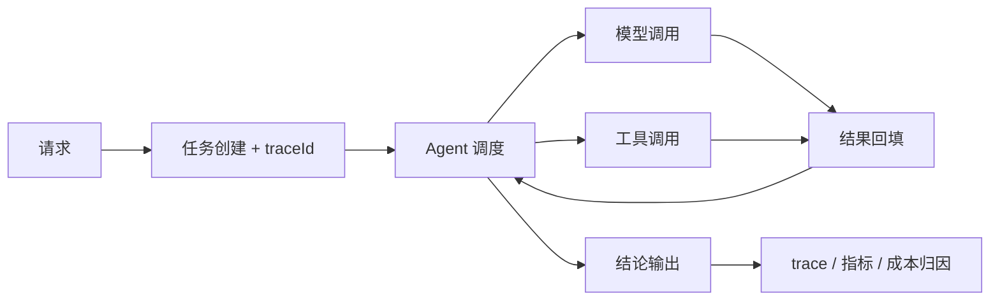

# Implementation Plan：Strata 通用智能体平台

**Feature ID**: `001-strata-platform`
**Spec**: [`./spec.md`](./spec.md)
**Status**: Draft
**Author**: Caspian | **Reviewers**: Caspian（单人仓库阶段，评审人待扩充）
**Last Updated**: 2026-11-13

## 1. 摘要（Summary）

采用六层能力栈分层建设：框架层与工具调用先形成可运行底座，单 Agent 在其上完成最小闭环，多 Agent 与 Graph 工作流分别承载协作与长任务编排，运维可观测横切所有层。六项创新能力不单独造轮子，而是嵌入对应层（MCP 网关属于工具调用层，可恢复工作流属于 Graph 层，冲突裁决属于多 Agent 层，可观测与评测横切，记忆与 RAG 独立成模块）。四个业务场景在底座与创新项就绪后复用同一套接口交付。主线框架、存储与中间件暂不锁定，由 ADR 决策后回填。

## 2. 技术上下文（Technical Context）

| 项 | 选择 | 理由 / 约束 |
| --- | --- | --- |
| 语言/版本 | Java（版本待决策，ADR-0002） | JVM 生态可同时覆盖 Spring AI 与 LangChain4j 两条候选路线 |
| 框架/主要依赖 | Spring AI 或 LangChain4j（待决策，ADR-0002） | 二选一作主线，避免双主线维护成本；否决同时接入两条主线 |
| 存储 | 待决策（ADR-0003）：关系库、向量库、检查点存储分别评估 | 记忆、评测、检查点的读写特征不同，不宜强行共用一种存储 |
| 测试 | JUnit 5 + 桩模型；集成测试容器方案待决策 | 保证无真实 Key 时可跑全量测试 |
| 部署形态 | 本地进程 + 单机容器（容器方案待决策） | 以可演示、可复现为优先，不追求集群 |
| 性能目标 | 编排与工具调度额外开销 p95 < 500ms；端到端问答 p95 < 8s（暂定基线） | 由后续压测脚本校准，见 NFR-1 |

## 3. 宪法符合性检查（Constitution Check，GATE）

| Article | 结论（Pass / Exception） | 证据或例外说明 |
| --- | --- | --- |
| I 文档先行与规格即契约 | Pass | 本文档与 `spec.md`、`tasks.md` 构成基线；任务均引用 FR/AC |
| II 每层必须有可运行证据与测试 | Pass | 各阶段均以"可运行命令 + 测试"为 Checkpoint，见 §8 |
| III 敏感信息零入库与受控执行 | Pass | 配置经环境变量注入（tasks T012）；工具白名单（T021–T023）；CI 密钥扫描（T013、T102） |
| IV 自主设计与对外口径一致 | Pass | 对外文案统一口径；发布前走查（T104） |
| V 可观测优先 | Pass | traceId 自底座阶段落地（T024），指标与成本归因见 T070–T075 |
| VI 简约与复杂度留痕 | Pass | 分层与模块划分在 §7 登记 |
| VII 代码注释与语言规范 | Pass | 落地规则见 §11；CI 检查见 T013、T102 |

**Gate 结论**：Pass

## 4. 架构与数据流（Architecture & Data Flow）

- 组件与职责：
  - 框架层：模型接入适配、模型参数配置、超时与重试。
  - 工具调用层：工具注册表、受控执行器（白名单/超时/沙箱）、Function Calling 适配、MCP 客户端。
  - 单 Agent 层：任务循环、上下文构建、工具选择、终止判定。
  - 多 Agent 层：角色注册、消息路由、冲突裁决、共识输出。
  - Graph 工作流层：定义解析、节点执行、条件分支、检查点、人工介入、修正回退。
  - 运维可观测层：trace 采集、任务级指标、心跳检测、成本归因、评测与回归基线。
  - 创新模块：MCP 网关（权限/审计/限流/沙箱）、持久记忆与高级 RAG、评测基线。
- 提议的仓库结构（随 ADR-0002 确认后调整）：

```text
strata-agent/
├── .specify/memory/constitution.md
├── specs/001-strata-platform/
├── docs/adr/
├── platform/
│   ├── framework-adapter/
│   ├── tool-runtime/
│   ├── agent-core/
│   ├── agent-collab/
│   ├── workflow-graph/
│   ├── agent-observability/
│   ├── mcp-gateway/
│   ├── memory-rag/
│   └── eval-harness/
├── examples/                 # 9 个示例模块，清单待确认
├── scenarios/
│   ├── qa-assistant/
│   ├── contract-review/
│   ├── content-studio/
│   └── data-analyst/
└── scripts/
```

- 请求/数据流：请求进入 → 创建任务与 traceId → Agent 调度 → 模型调用 / 工具调用 → 结果回填 → 结论输出 → trace 与指标落盘。
- 时序/状态变化：



- 失败路径：模型超时按上限退避；工具失败回填给 Agent；重复调用触发步数上限；工作流中断依赖检查点恢复；成本超限熔断；模型不可用时切换桩模型。

## 5. 接口与契约（Interfaces & Contracts）

| 接口 | 提供方 | 消费方 | 契约文件 | 版本 | 破坏性变更 |
| --- | --- | --- | --- | --- | --- |
| 任务提交与查询（HTTP 路径待决策） | platform | examples、scenarios | `contracts/openapi.yaml`（待生成） | v1 | — |
| ChatModel SPI | framework-adapter | agent-core | 代码内接口（待实现） | — | — |
| ToolRegistry SPI | tool-runtime | agent-core、mcp-gateway | 代码内接口（待实现） | — | — |
| 工作流定义 schema | workflow-graph | scenarios | `contracts/workflow-schema.json`（待生成） | v1 | — |
| 评测报告格式 | eval-harness | scenarios、docs | `contracts/eval-report.schema.json`（待生成） | v1 | — |

- 错误码：按域前缀划分——`E-MODEL-*`（模型）、`E-TOOL-*`（工具）、`E-WORKFLOW-*`（工作流）、`E-PERM-*`（权限）、`E-EVAL-*`（评测）；明细表在实现阶段补齐（T100）。
- 兼容策略：优先新增字段；删除或改语义必须保留弃用期并在 PR 说明消费方迁移。
- 契约测试：provider 侧与 consumer 侧测试文件在对应模块实现时补齐，路径随模块结构确定。

## 6. 数据模型（Data Model）

- 实体与关系：会话 1–N 任务；任务 1–N 模型调用与工具调用；工作流定义 1–N 实例；实例 1–N 检查点；会话 1–N 记忆条目；评测集 1–N 基线。
- 迁移方案：待决策（ADR-0003）确定存储后，采用纯增量建表，禁止修改既有列。
- 回滚方案：新增表以 `DROP TABLE` 回滚；不可逆的数据变更需先提供补偿脚本。
- 数据保留/脱敏：日志对密钥、完整提示词与个人敏感字段脱敏；评测数据只使用样例与脱敏内容；记忆条目支持按会话删除。

## 7. 复杂度与例外登记（Complexity Tracking）

| 引入的复杂度 | 为什么必须 | 否决的更简方案及原因 | 批准人 | 复核日期 |
| --- | --- | --- | --- | --- |
| 单仓多模块：六层 + 创新模块 + 示例 + 场景 | 每层需独立可运行、独立测试，且层间依赖必须单向可查 | 单模块大包：无法逐层验证，也无法按层认领任务 | Caspian | 2026-12-15 |
| 独立 MCP 网关模块 | 权限、审计、限流、沙箱是外部工具接入的前置约束，混在工具执行器内无法独立演进 | 复用工具执行器：审计与限流职责耦合，测试边界不清 | Caspian | 2026-12-15 |
| 自建可恢复工作流状态机 | 需要"检查点 + 人工介入 + 修正回退"的组合能力，通用编排组件难以同时满足 | 直接嵌入通用状态机库：组合语义仍需自建，反而多一层适配 | Caspian | 2026-12-15 |

## 8. 交付与验证策略（Delivery & Verification）

- 实施顺序（与 `tasks.md` 阶段一一对应）：
  - S0 规格与决策基线：本轮产出，无代码。
  - S1 工程基线：构建、配置、密钥管理、CI、测试脚手架。
  - S2 底座：框架层 + 工具调用层。
  - S3 单 Agent（US-1、US-2 的单 Agent 部分）。
  - S4 多 Agent 协作（US-2）。
  - S5 可恢复 Graph 工作流（US-3）。
  - S6 MCP 工具网关（US-4）。
  - S7 运行时可观测与评测基线（US-5）。
  - S8 持久记忆与高级 RAG（US-6）。
  - S9 四个业务场景端到端（US-7）。
  - S10 收尾：错误码表、quickstart、演示脚本、文档一致性。
- 依赖关系：S1 → S2 → S3 → S4 / S5（可并行）；S2 → S6；S3 → S7；S3 → S8；S4、S5、S6、S7、S8 → S9。
- 测试先行：每层先提交失败测试（正常路径 + 异常路径），再提交实现；对应 AC 见 `tasks.md`。
- 手工验证：`docs/quickstart.md` 按层给出编号步骤（T101 产出）。
- 观测与告警：traceId、任务耗时、token、成本、心跳、假死次数、评测通过率；阈值在 S7 确定。
- 灰度/开关：真实模型与桩模型通过配置切换，默认桩模型；工具白名单默认拒绝。

## 9. 风险（Risks）

| 风险 | 影响 | 概率 | 缓解措施 | 触发后的应对 |
| --- | --- | --- | --- | --- |
| 明文密钥、写死绝对路径、可执行任意命令的工具 | 高 | 中 | 环境变量占位、工具白名单、路径检查、CI 密钥扫描 | 立即移除并轮换凭据，补回归测试 |
| 主线框架迟迟不定导致底座反复返工 | 高 | 中 | 先用 SPI 隔离模型接入，选型确认后只替换适配实现 | 冻结上层开发，先完成 ADR-0002 |
| 模型服务不可用或限流 | 中 | 高 | 桩模型 + 可回放记录；重试退避 | 切桩模型演示，真实调用改为异步补测 |
| 六层抽象空转，只有骨架没有行为 | 高 | 中 | 每层以"可运行命令 + 测试"为唯一完成判据 | 停止新增层，回头补齐证据 |
| 成本与 token 失控 | 中 | 中 | 任务级成本归因 + 熔断阈值 | 熔断并输出已用成本，人工介入 |
| 工作量超出 43–63 人日区间 | 中 | 中 | 按阶段交付，每阶段独立可演示 | 缩减创新项深度，保留主干 |
| 单人仓库缺少评审 | 中 | 高 | 自查清单化，PR 必跑代码审查 | 补一次外部评审 |
| 9 个示例模块清单未定导致任务无法拆分 | 高 | 高 | 列为阻塞待澄清项，优先确认 | 先做与清单无关的底座任务 |

## 10. 未决问题（Open Questions）

- [ ] 主线框架选 Spring AI 还是 LangChain4j —— 负责人：Caspian，截止：待定，阻塞：是（预留 ADR-0002）
- [ ] 存储与中间件选型（关系库、向量库、检查点存储、缓存/队列）—— 负责人：Caspian，截止：待定，阻塞：是（预留 ADR-0003）
- [ ] 模型服务接入方式与额度 —— 负责人：Caspian，截止：待定，阻塞：否（预留 ADR-0004）
- [ ] 9 个示例模块清单与六层映射 —— 负责人：Caspian，截止：待定，阻塞：是（预留 ADR-0005）
- [ ] 构建工具与 Java 版本 —— 负责人：Caspian，截止：待定，阻塞：是（并入 ADR-0002）
- [ ] 是否提供独立前端控制台 —— 负责人：Caspian，截止：待定，阻塞：否（预留 ADR-0006）
- [ ] 部署形态与演示环境 —— 负责人：Caspian，截止：待定，阻塞：否（预留 ADR-0007）

## 11. 编码规范（Coding Conventions）

- 注释语言：代码注释与日志文案一律使用英文；中文仅出现在文档（`spec.md`、`plan.md`、ADR、README 及同类说明）中。
- Javadoc：所有公开类、接口、方法必须编写英文 Javadoc，说明职责、参数、返回值与关键副作用；作者统一标注 `@author Caspian`。
- 日志：使用结构化字段，必须携带 traceId 及可独立排查问题的上下文（任务 ID、工具名、状态、耗时）；不得输出密钥、完整提示词与个人敏感信息。
- 异常与错误码：对外抛出的异常必须映射到 §5 的错误码域；禁止静默吞错。
- 测试命名：测试方法名使用英文并表达"场景 + 期望"，与 AC 编号在注释中对应。
- 静态检查：CI 必须校验"公开 API 是否有 Javadoc""注释与日志是否含中文"，未通过不得合并；具体检查工具随构建工具选型确定（ADR-0002）。
